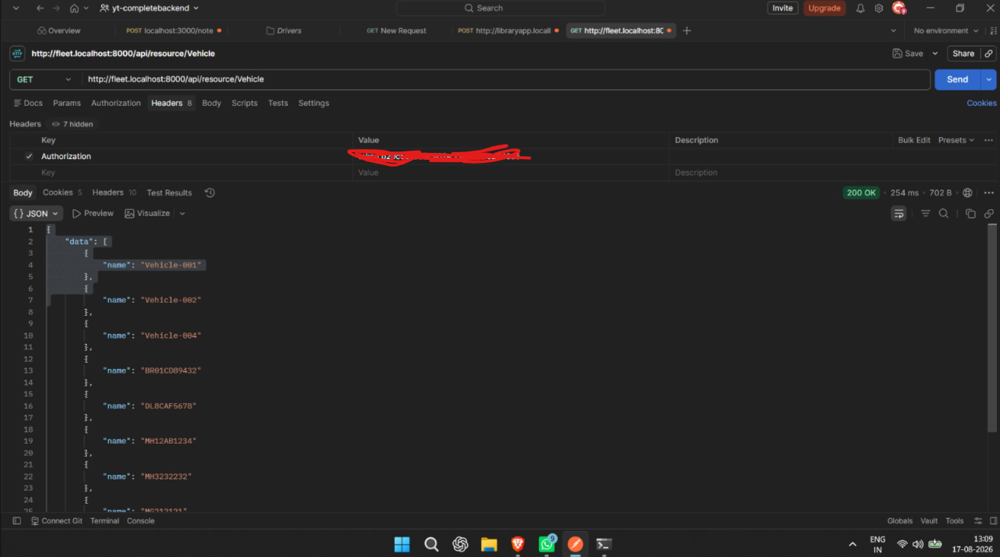
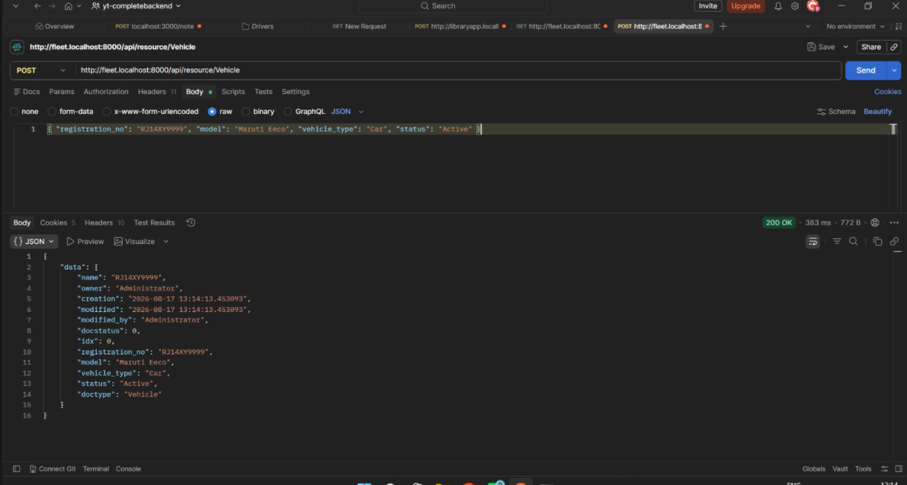
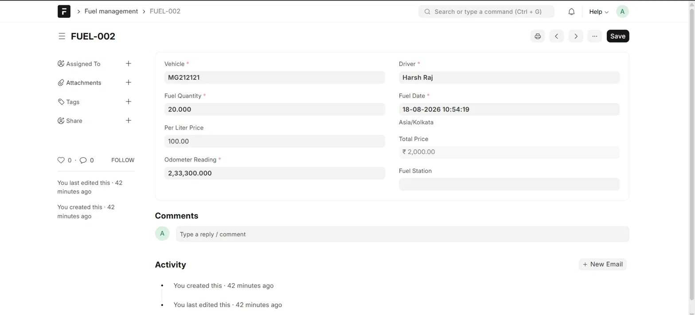
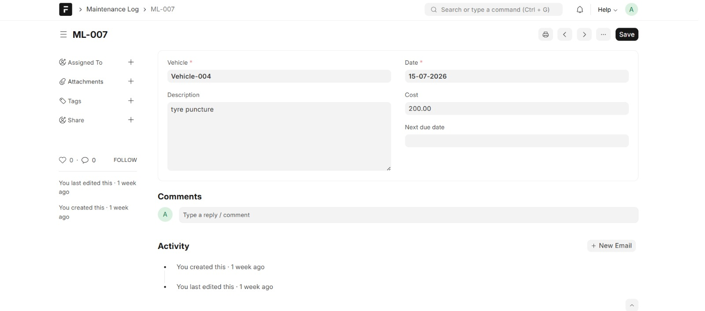

## Demo Video and screenshot

[Watch the full demo](https://www.loom.com/share/447d47d15cff4a209d89002e1749ae6a)

The video covers Vehicle, Driver, and Trip creation with auto-calculated expenses. Fuel Management and Maintenance Log are shown below via screenshots.


# Fleet Management

A Frappe app to manage a vehicle fleet end-to-end — vehicles, drivers, trips, fuel logs, and maintenance records — built on the Frappe Framework.

## Features

- **Vehicle** — maintain a master record for each vehicle (registration number, model, vehicle type, status, and assigned driver).
- **Driver** — track driver details (name, phone number, license number, status) and link them to vehicles and trips.
- **Trip** — log trips with start/end location, start/end date, distance covered, assigned vehicle and driver, trip status, and linked trip expenses with an auto-calculated total.
- **Trip Expense** — record individual expenses (type, amount, description) tied to a trip.
- **Fuel Management** — log refueling entries with quantity, price per liter, odometer reading, fuel station, and auto-calculated total cost.
- **Maintenance Log** — track servicing and repairs per vehicle, including cost, date, and the next due date.

## Installation

You can install this app using the [bench](https://github.com/frappe/bench) CLI:

```bash
cd $PATH_TO_YOUR_BENCH
bench get-app $URL_OF_THIS_REPO --branch develop
bench install-app fleet_management
```

## Usage

Once installed, the Fleet Management doctypes are available from the Frappe desk. A typical flow looks like:

1. Add your **Vehicles** and **Drivers**.
2. Create a **Trip**, assigning a vehicle and driver, and add any **Trip Expenses** incurred.
3. Log fuel fill-ups against a vehicle in **Fuel Management**.
4. Record servicing and repairs in **Maintenance Log**, including the next service due date.


## API Usage

The app exposes standard Frappe REST endpoints. API calls were tested using Postman.

**Authentication:** Generate an API Key and Secret from **My Settings → API Access** in the Frappe desk. In Postman, add a header:
- Key: `Authorization`
- Value: `token API_KEY:API_SECRET`

### Fetch all vehicles (GET)

- Method: `GET`
- URL: `http://your-site/api/resource/Vehicle`
- Headers: `Authorization: token API_KEY:API_SECRET`



### Create a vehicle (POST)

- Method: `POST`
- URL: `http://your-site/api/resource/Vehicle`
- Headers: `Authorization: token API_KEY:API_SECRET`, `Content-Type: application/json`
- Body (raw JSON):
```json
{
  "registration_no": "RJ14XY9999",
  "model": "Maruti Eeco",
  "vehicle_type": "Car",
  "status": "Active"
}
```



### Fuel Management


*Total price is auto-calculated from fuel quantity × per liter price.*

### Maintenance Log



## Contributing

This app uses `pre-commit` for code formatting and linting. Please [install pre-commit](https://pre-commit.com/#installation) and enable it for this repository:

```bash
cd apps/fleet_management
pre-commit install
```

Pre-commit is configured to use the following tools for checking and formatting your code:

- ruff
- eslint
- prettier
- pyupgrade

## CI

This app uses GitHub Actions for CI. The following workflows are configured:

- **CI**: Installs this app and runs unit tests on every push to the `develop` branch.
- **Linters**: Runs [Frappe Semgrep Rules](https://github.com/frappe/semgrep-rules) and [pip-audit](https://pypi.org/project/pip-audit/) on every pull request.

## License

MIT
